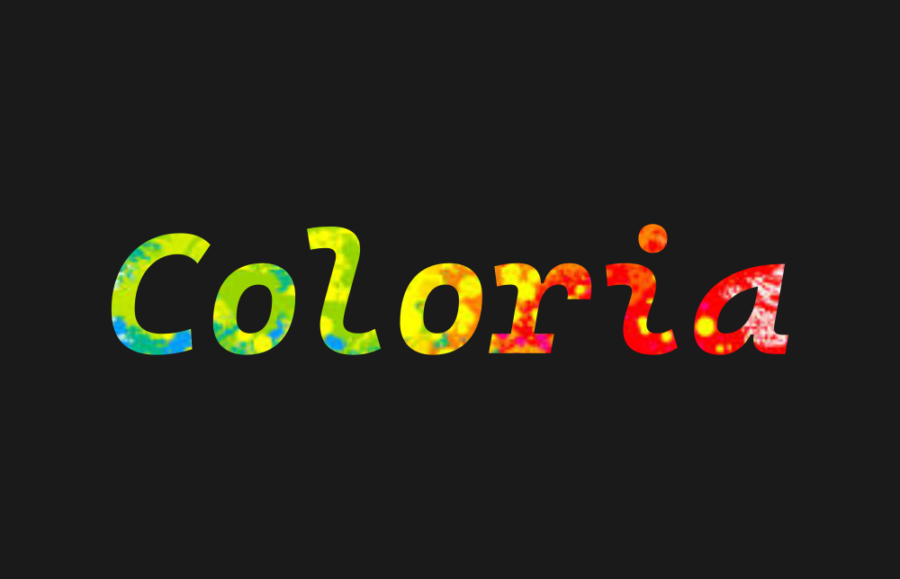
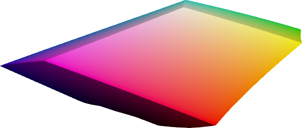
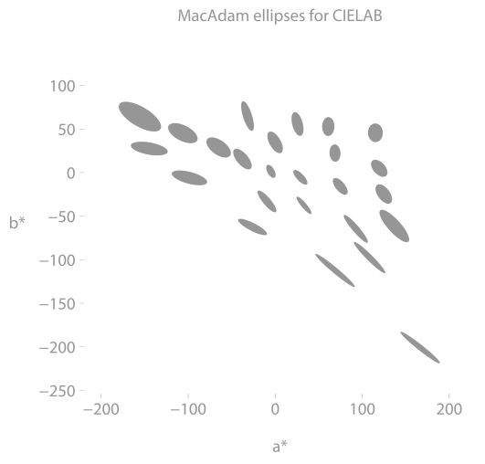
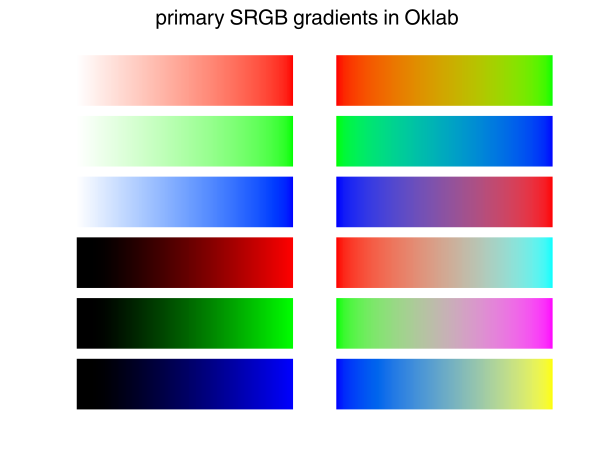

<p align="center">
  <a href="https://github.com/coloria-dev/coloria"></a>
  <p align="center">Tools for color research.</p>
</p>

[](https://pypi.org/project/coloria/)
[](https://pypi.org/project/coloria/)
[](https://github.com/coloria-dev/coloria)
[](https://pepy.tech/project/coloria)

<!--[](https://pypistats.org/packages/coloria)-->

[](https://discord.gg/hnTJ5MRX2Y)

Coloria is a Python library for color science: color spaces, color appearance
models, color difference formulas, chromatic adaptation transforms, and the
experimental data to judge them by. All methods are fully vectorized, so they
are fast on one color or a million.

**[Documentation](https://mondaytech.com/coloria/docs/)** · [Pricing](https://mondaytech.com/coloria/license/)

### Installation

Install Coloria [from PyPI](https://pypi.org/project/coloria/) with

```
pip install coloria
```

Coloria needs a license to run. The first time you use it in a terminal, it
offers to start a free 30-day trial, to take a license key you already have, or
to [buy one online](https://mondaytech.com/coloria/license/). See
[Get started](https://mondaytech.com/coloria/docs/) for the details.

### Example

Average yellow and blue in sRGB and you get a mid gray. Do it in a perceptual
space such as Oklab and you get the color you expected:

```python
from coloria.cs import ColorCoordinates

c0 = ColorCoordinates([1.0, 1.0, 0.0], "srgb1")  # yellow
c1 = ColorCoordinates([0.0, 0.0, 1.0], "srgb1")  # blue

c0.convert("oklab")
c1.convert("oklab")

c2 = (c0 + c1) * 0.5
c2.convert("srgbhex", mode="clip")

print(c2.data)
```

<!--pytest-codeblocks:expected-output-->

```
#6cabc7
```

### What's inside

|  |  |  |
| :-------------------------------------------------------------------------------------------------------------: | :--------------------------------------------------------------------------------------------------------------: | :-----------------------------------------------------------------------------------------------------------: |
|                                            The sRGB gamut in CIELAB                                             |                                            MacAdam ellipses in CIELAB                                            |                                              Gradients in Oklab                                               |

- [Color coordinates and spaces](https://mondaytech.com/coloria/docs/color-spaces/): XYZ, xyY, sRGB, CIELAB,
  CIELUV, DIN99, CAM02-UCS, CAM16-UCS, J<sub>z</sub>a<sub>z</sub>b<sub>z</sub>,
  ICtCp, proLab, Oklab, HCT and more
- [Color appearance models](https://mondaytech.com/coloria/docs/appearance-models/): CIECAM02, CAM16, ZCAM
- [Color difference formulas](https://mondaytech.com/coloria/docs/color-differences/): CIE76, CIE94, CIEDE2000,
  CMC l:c
- [Chromatic adaptation transforms](https://mondaytech.com/coloria/docs/chromatic-adaptation/): von Kries,
  Bradford, CAT02, CAT16 and more
- [Illuminants and observers](https://mondaytech.com/coloria/docs/illuminants-observers/)
- [Gamut visualization](https://mondaytech.com/coloria/docs/gamut-visualization/) and
  [color gradients](https://mondaytech.com/coloria/docs/gradients/)
- [Experimental data](https://mondaytech.com/coloria/docs/experimental-data/): MacAdam, Luo-Rigg, Munsell,
  Ebner-Fairchild, Hung-Berns, Xiao, Fairchild-Chen
- [API reference](https://mondaytech.com/coloria/docs/reference/)

### Articles

- [Algorithmic improvements for the CIECAM02 and CAM16 color appearance models,
  Nico Schlömer, 2018](https://arxiv.org/abs/1802.06067)
- [On the conversion from OSA-UCS to CIEXYZ, Nico Schlömer,
  2019](https://arxiv.org/abs/1911.08323)

### Support

Write to [coloria@mondaytech.com](mailto:coloria@mondaytech.com).
